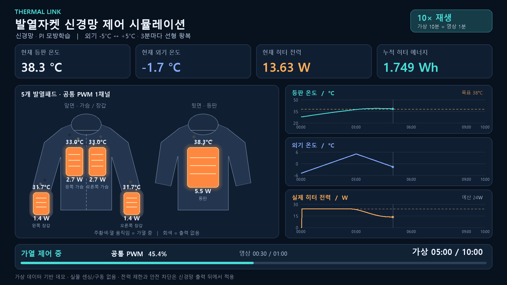

# THERMAL LINK — Rev.C 파이썬 가상 실험실

[](https://thermallink-jacket-simulator.streamlit.app/)

**[▶ 시뮬레이터 실행 — 설치 없이 웹에서 체험](https://thermallink-jacket-simulator.streamlit.app/)** · [1분 데모 영상](outputs/THERMAL_LINK_10x_60s.mp4)

**Rev.C FIRMWARE-AI 인터페이스**를 기준으로 작성한 실행 가능한 제어 코드와 시뮬레이터입니다. 5개 발열패드, NTC 5개, 공통 PWM 1채널을 사용합니다.

실물 정격과 열 특성이 제공되지 않아 모든 기본 파라미터를 **검증되지 않은 시뮬레이션 가정값**으로 분리했습니다. 실물 ESP32 제어 코드는 포함하지 않습니다. PI 제어와 가상 데이터로 PI를 모방 학습한 소형 신경망을 선택할 수 있습니다.

## 움직이는 시뮬레이션과 신경망

- 실행 버튼을 누르면 가상 0초부터 재생합니다. 현재 등판·외기 온도, 현재 히터 전력, 누적 에너지가 0.5초마다 갱신됩니다.
- 외기 기본값은 **0초 −5°C → 180초 +5°C → 360초 −5°C**의 연속 선형 왕복입니다. 모든 패드의 실제 열손실 계산에 반영합니다. 고정 외기도 선택할 수 있습니다.
- 기본 속도는 **10배**이며 1/5/10/30/60배로 바꿀 수 있습니다. 10배에서는 가상 3분이 실제 18초입니다. 일시정지·재개·처음부터 재생·전체 결과 보기 버튼이 있습니다.
- 자켓 그림의 주황색 밝기와 떠오르는 열 표시는 **패드별 실제 적용 전력**에 연동합니다. 차단되거나 분리된 패드는 효과가 꺼집니다. 피부 온도나 열화상 영상은 아닙니다.
- 계산 자체는 먼저 끝내고 기록을 시간 순서대로 재생합니다. 설정 변경은 실행 버튼으로 새 시뮬레이션을 시작할 때 반영합니다.
- **신경망 구조 · 학습 · PI 비교**를 펼치면 구조, 학습 곡선, 재학습 버튼, 같은 조건의 PI 비교를 볼 수 있습니다.

신경망은 `온도 오차·적분 상태 2개 → tanh 16개 → tanh 8개 → sigmoid 1개`의 MLP입니다. 학습 가상 상태 8,000개, 별도 검증 상태 2,000개로 PI 요청 듀티를 모방합니다. 적분 상태 갱신은 기존 PI 규칙을 사용하고, 외기는 열 모델과 등판 센싱값을 통해 간접 반영합니다. 실물 데이터 학습이나 독립적인 최적 제어 학습으로 해석하면 안 됩니다. 전력 제한과 오류 차단은 신경망 뒤의 별도 계층이 담당합니다.

모델은 `models/pi_imitation.json`, 재학습 코드는 `train_neural.py`와 `thermallink/training.py`입니다. 추론은 표준 라이브러리, 학습은 NumPy를 사용합니다. NumPy는 화면 실행 환경에 함께 설치되어 있습니다.

```powershell
.\.venv\Scripts\python.exe train_neural.py --epochs 160
.\.venv\Scripts\python.exe simulate.py --controller neural --ambient-profile triangle --duration 600 --output outputs/neural_demo
```

## GitHub Codespaces에서 개발하기

체험은 상단 **시뮬레이터 실행** 링크를 이용합니다. 코드를 수정하며 실행하려면 **Code → Codespaces → Create codespace on main**을 선택합니다. Python 3.12와 화면 패키지가 준비되면 터미널에서 실행합니다.

```bash
python -m streamlit run app.py --server.address 0.0.0.0 --server.port 8501
```

**Ports** 탭의 `8501`에서 **Open in Browser**를 누르면 시뮬레이터가 열립니다. 포트 공개 범위는 기본 비공개로 유지합니다. 사용 후 Codespace를 중지하세요. 생성·실행은 사용자 계정의 Codespaces 사용량에 포함됩니다. [GitHub 공식 안내](https://docs.github.com/en/codespaces/setting-up-your-project-for-codespaces/adding-a-dev-container-configuration/setting-up-your-python-project-for-codespaces)

## 바로 실행하기

Python 3.11 이상이 설치된 Windows PC에서 실행합니다. 실행에 필요한 `.venv`와 화면 패키지는 최초 실행 시 준비합니다.

1. `start_simulator.bat`를 더블클릭합니다.
2. 브라우저에서 시나리오와 목표 온도·전력 예산을 선택합니다.
3. **시뮬레이션 실행**을 누릅니다.
4. 온도·PWM·전력 그래프와 이벤트를 확인하고 CSV를 다운로드합니다.

기본 주소는 `http://127.0.0.1:8501`입니다. 이미 실행 중인 화면이 있으면 해당 주소를 열면 됩니다. 새로 실행한 콘솔에서 `Ctrl+C`를 누르면 서버가 종료됩니다. 외부 공개 없이 이 컴퓨터에서만 접속합니다.

아래 명령으로 11개 시나리오를 계산한 뒤 `outputs/report.html`을 브라우저로 열면 결과를 볼 수 있습니다.

## 10배속 · 1분 데모 영상

[Full HD MP4 보기](outputs/THERMAL_LINK_10x_60s.mp4) — 가상 10분을 실제 60초로 재생합니다. 외기 온도 변화, 신경망 PI 모방 제어, 5개 패드 발열 효과와 누적 에너지를 함께 표시합니다.

[](outputs/THERMAL_LINK_10x_60s.mp4)

동일 영상을 다시 생성하려면 실행 환경을 준비한 뒤 다음 명령을 사용합니다. 영상은 가상 데이터 기반이며, 실물 측정 영상이 아닙니다.

```powershell
.\.venv\Scripts\python.exe -m pip install -r requirements-video.txt
.\.venv\Scripts\python.exe export_video.py
```

출력은 `outputs/THERMAL_LINK_10x_60s.mp4`이며, 1920×1080 / 24fps / H.264 형식입니다. 저장소에는 데모 영상과 미리보기를 포함하고, 실행 로그와 재생성 가능한 계산 결과는 제외합니다.

## 명령으로 실행하기

프로젝트 폴더에서 PowerShell을 엽니다.

```powershell
# 화면 실행
.\.venv\Scripts\python.exe -m streamlit run app.py --server.address 127.0.0.1

# 전체 11개 시나리오, 각 600초
.\.venv\Scripts\python.exe simulate.py --all --duration 600 --config config/simulation.json

# 장갑 분리만 시험
.\.venv\Scripts\python.exe simulate.py --scenario glove_detach --duration 150 --output outputs/glove_demo

# 자동 제어 대신 50% PWM 요청
.\.venv\Scripts\python.exe simulate.py --scenario normal --duty 50 --duration 600 --output outputs/manual_demo

# 자동 테스트
.\.venv\Scripts\python.exe -m unittest discover -s tests -v
```

새 PC에서는 Python 3.11 이상이 필요합니다. 기본 시뮬레이션과 제어 테스트는 추가 패키지가 필요 없습니다. 화면 기능만 `requirements.txt`의 Streamlit을 사용합니다.

```powershell
python -m venv .venv
.\.venv\Scripts\python.exe -m pip install -r requirements.txt
```

화면 실행과 테스트 기능은 [Streamlit 실행 문서](https://docs.streamlit.io/develop/api-reference/cli/run), [Streamlit AppTest 문서](https://docs.streamlit.io/develop/api-reference/app-testing/st.testing.v1.apptest)를 참고했습니다.

## 구현한 기능

| 항목 | 구현 |
|---|---|
| 패드 | `BACK`, `CHEST_L`, `CHEST_R`, `GLOVE_L`, `GLOVE_R` |
| 기본 온도 제어 | `BACK` NTC 기반 PI 또는 학습된 PI 모방 신경망, 전력 제한 시 적분 누적 방지 |
| 센서 감시 | 장착된 모든 NTC의 오류·범위·샘플 시각 확인 |
| 공통 PWM | 요청 % → 0~1 전력 제한 → 최종 안전 출력 % |
| 평균 전력 부족 | `POWER_LIMITED`, 제한된 출력 유지 |
| 순간 과전류 | 듀티와 관계없이 출력 금지·오류 래치 |
| 장갑 연결 변화 | 운전 중 전체 PWM 0, `RECONNECT_HOLD`, 안정 후 별도 START |
| 오류 해제 | 원인 해소 + 온도 복귀 + RESET → READY, 별도 START 필요 |
| 물리 온도 스위치 | 패드별 개방/냉각 복귀, 해당 패드 실제 전력만 차단 |
| 결과 | CSV, 이벤트 JSON, 사용 설정 JSON, SVG 그래프, HTML 보고서 |

고장 시나리오의 RESET/START는 정해진 시각에 시뮬레이터가 **사용자 조작 이벤트로 주입**합니다. 제어기가 오류에서 자동 재가동하는 기능이 아닙니다. 실제 코드에서는 해당 명령이 없으면 차단을 유지합니다.

## 시나리오

| 이름 | 시험 내용 |
|---|---|
| `normal` | 정상 등판 온도 제어 |
| `power_limited` | 히터 평균 예산 최대 8W |
| `glove_detach` | 60초 왼쪽 장갑 분리, 100초 START |
| `both_detached` | 양쪽 장갑이 없는 상태로 부팅 |
| `sensor_open` | 오른쪽 가슴 NTC 단선 |
| `stale_sample` | 왼쪽 장갑 NTC 샘플 지연 |
| `overtemp` | 등판 NTC에 51°C 고장 조건 주입 |
| `peak_current` | 버스 13V로 PWM ON 공급원 전류 한도 초과 |
| `voltage_fault` | 공급원·버스 8V 저전압 |
| `switch_cycle` | 왼쪽 장갑 스위치 국부 열 주입과 냉각 복귀 |
| `unstable_contact` | 오른쪽 장갑 접점 불안정 |

고장 조건은 주로 60~90초에 주입하고 100초 RESET, 110초 START를 요청합니다. 모든 이벤트를 보려면 150초 이상 실행하세요. 설정을 변경하면 특정 시나리오가 의도한 고장 한도를 넘지 않거나 다른 고장이 먼저 발생할 수 있습니다.

## 주요 파일

```text
app.py                     그래프와 파라미터 조정 화면
simulate.py                추가 패키지 없는 명령행 실행
export_video.py            10배속 60초 MP4 생성
requirements-video.txt     영상 저장용 선택 의존성
config/simulation.json     전기·열·제어 가정값
thermallink/models.py      데이터 구조와 설정 검증
thermallink/power.py       allocate_power() 전력 제한 함수
thermallink/safety.py      단일 오류 래치와 최종 PWM 안전 게이트
thermallink/controller.py  등판 PI 제어
thermallink/neural.py      학습된 MLP 추론과 제어
thermallink/training.py    가상 데이터·역전파·Adam 학습
thermallink/environment.py 외기 선형 왕복 프로파일
thermallink/playback.py    일시정지·속도·재생 시계
thermallink/heating_view.py 실제 패드 전력 기반 발열 그림
thermallink/video_frames.py 영상용 대시보드 프레임 생성
thermallink/virtual.py     5패드 열 모델과 물리 온도 스위치
thermallink/adapters.py    공통 입출력 계약 및 ESP32 미구현 경계
thermallink/simulation.py  시나리오·이벤트 실행
thermallink/reporting.py   CSV·JSON·SVG·HTML 생성
tests/                    제어·안전·열 모델·화면 테스트
docs/INTERFACE_CONTRACT.md 충돌 해결 및 구현 결정
outputs/                  실행 결과와 보고서
```

## 기본 가정과 해석 범위

기본 저항은 등판 12Ω, 가슴 각 24Ω, 장갑 각 48Ω입니다. 12V에서 ON 전력은 각각 12/6/6/3/3W로 총 30W입니다. 공통 듀티가 80%일 때 총 히터 전력은 24W입니다. 이 숫자는 실물 측정값이나 패드 정격이 아닙니다. `rated_power_w`는 미확정이므로 `null`로 남겨 두었습니다.

공급원·히터 버스 전압은 별도 필드이며 기본 시나리오에서만 둘 다 12V입니다. 효율 90%는 공급원 히터 분기 입력에서 버스 출력까지 한 번 적용합니다. MCU 등 비발열 전력 1W는 공급원 측에서 차감합니다.

기본 NTC 차단 48°C, RESET 허용 42°C, 샘플 최대 지연 1.5초, 연결 안정 대기 2초, 제어 주기 0.5초, 최대 제어 간격 2초입니다. 물리 스위치 트립은 원문의 55°C이며 복귀 48°C와 스위치 위치의 5초 열 지연은 가정입니다.

열 모델은 패드별 집중 열용량과 외기·신체로의 선형 열손실을 사용합니다. 배터리 방전, 전원 협상, 패드 저항의 온도 변화, 접촉 압력, 피부·옷감 내부 온도 분포는 모델링하지 않습니다. 전류는 계산값이며 실제 측정값이 아닙니다. 물리 스위치 시험의 +40°C 국부 열은 스위치 개폐 로직을 분리 시험하기 위한 입력입니다.

화면의 물리 스위치 상태는 시뮬레이터만 아는 값입니다. ESP32 인터페이스로 전달하지 않으며 전력·순간 전류 검사는 장착된 스위치가 모두 닫힌 상태를 가정합니다. 가상 실제 전력은 각 스위치의 실제 개폐 상태를 반영합니다.

CSV의 `time_s`는 구간 시작, `interval_end_s`는 끝입니다. 온도는 시작 샘플, 실제 전력은 구간 평균, 누적 에너지·스위치 상태는 끝 기준입니다. `sensor_*_valid`가 거짓인 온도는 안전 판단용 정상 측정으로 해석하면 안 됩니다. `plant_*_c`는 고장 주입과 무관한 가상 물리 온도입니다.

소프트웨어가 정지하면 이 파이썬 루프 자체로는 출력을 차단할 수 없습니다. 실제 포팅에는 독립적인 하드웨어 보호·워치독·기본 OFF 회로·ADC 변환·핀 매핑·실측 정격 검증이 필요합니다. ESP32 클래스는 이 경계를 숨기지 않도록 `NotImplementedError`를 발생시킵니다.
